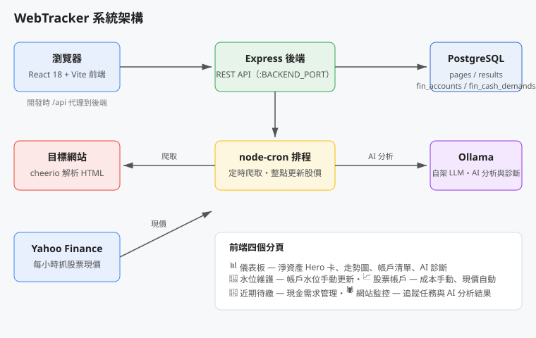
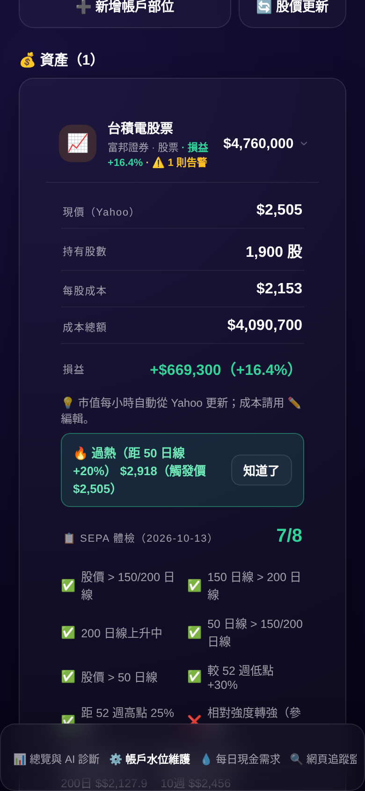

# WebTracker

個人財務儀表板 + AI 網站監控工具：追蹤帳戶水位與股票部位、定時爬取你指定的網頁並用自架 LLM 依你的 prompt 做分析，結果都呈現在同一個手機友善的儀表板上。





## 功能

### 📊 財務儀表板（dashboard）
- 淨資產 Hero 卡＋面積走勢圖，指標可在淨資產／現金／投資之間切換
- 橫滑小卡、流動性橫幅、帳戶清單、近期待繳一覽
- **AI 診斷**：綜合帳戶水位、待繳現金需求與最新網站監控摘要，由 Ollama 生成建議

### 📝 水位維護（maintenance）
- 帳戶卡片點一下展開，大數字輸入框＋ ±1 萬／±10 萬快速鍵
- 每筆帳戶可單獨儲存；未儲存的帳戶顯示橘點提醒
- 點「總資產」卡可展開各類型分組（現金／定存／股票／外幣＋小計），點類型即篩選列表，再點一次取消；篩到股票時出現「📋 全部體檢」一鍵執行 SEPA
- **分級部位總覽**：第一級／第二級／試單／未分級／現金各佔總資產比例（條狀圖），第一級標 70% 上限、現金標 10% 目標，超標或不足直接標示提醒
- 有未儲存水位時底部浮出「N 項水位未儲存／全部儲存」列
- 新增帳戶彈窗（手機上為底部抽屜）
- 水位歷史去重：餘額沒變不寫入歷史（每小時股價更新在盤外價格不動時不會灌爆走勢圖）

### 📈 股票帳戶
- 股票代號、持有股數、**每股成本手動設定**
- **現價每小時整點從 Yahoo Finance 自動更新**，市值＝現價 × 股數
- 損益自動計算（帳戶列顯示損益 %，點開可見現價、成本總額、損益金額）
- **加碼買進**：輸入加碼股數與買進單價，後端自動重算加權平均成本；送出前即時預覽加碼後均價與總股數
- **賣出記錄**：輸入賣出股數與賣出單價，自動扣減股數並記錄實現損益；點開帳戶可見累計已實現損益與每筆賣出明細
- **股價提醒**：每檔股票可設停損價／目標價（股票計價幣別）；每小時更新時採邊緣觸發檢查，穿越即產生告警，帳戶列顯示 ⚠️ 徽章，點開可確認（知道了）
- **SEPA 每日體檢**：每天 14:00（Phoenix 時間，台美股皆收盤後）自動抓一年日線，計算 50/150/200 日線、10 週線、52 週高低，逐條檢查 8 條趨勢模板（第 8 條以相對大盤強弱為參考值）；每檔股票可設**持股分級**（第一級／第二級／試單），體檢區頂部的**行動建議**按分級給出（第一級：10 週線減半／200 日線出清；第二級・試單：破 50 日線出場；未分級：中性描述），為常駐狀態；行動訊號出現時可記錄**我的決定**（暫緩不動／已執行／之後再說），決定後訊號靜音、體檢照跑，訊號改變或次日體檢才重新提醒；規則告警（收盤破 50 日線／跌破 10 週線／跌破 200 日線／距成本 -7%／過熱 +20%）採邊緣觸發寫入告警系統；尚未體檢時可按「立即體檢」手動觸發

### 🤖 Agent 總開關與白名單
- **六個開關**：存在資料庫 `agent_settings`（不是環境變數），改了立即生效，不用重啟——總開關（關掉就壓過全部）、告警診斷（預設開）、每日健檢（預設開，正常不打擾）、批准動作執行（預設關，試點穩定後手動開）、對外通知（預設關，v1 只有站內告警）、最高權限（預設關，D 級總開關）
- **告警診斷**：新告警產生時 agent 用 Ollama 寫一段短診斷附在告警旁邊；Ollama 連不上時診斷直接缺件、不編造，SEPA 資料日期對不上觸發日時標示資料過期、不出診斷，執行中開關被關掉時直接中止、不留半成品
- **每日健檢**：每天 14:30（Phoenix 時間）檢查資料庫、Ollama、SEPA 體檢新鮮度，結果寫入稽核紀錄，正常不打擾，Ollama 異常會明確標示
- **白名單動作**：人點一次、只做一次——確認告警、重跑 SEPA 體檢、單檔重抓 Yahoo 股價、單頁重跑爬取、產生 advisor 報告；執行開關關著時按鈕停用並講明原因，不排隊偷跑
- **C 級永遠禁止**：改停損／目標價／門檻、分級、成本、股數，靜音或刪除告警，改網址／prompt／排程，任何交易、改資料庫結構、重啟服務——server 端強制擋下，只寫稽核不執行；但總開關關掉不影響資料層：每小時 Yahoo 抓價、每天 14:00 SEPA 體檢、網站爬取照常寫資料
- **D 級最高權限（動錢／改關鍵設定／對外下單）**：獨立入口，與 B 白名單分開；三道閘門（總開關＋最高權限開關＋逐筆點頭二次確認）＋單筆／每日金額上限（預設 0＝一律擋下，存 `agent_settings.value_num`）；第 1 階段動錢只接 mock（轉帳／付發票／換匯都標明未真的執行），不接 Stripe SDK、不碰金鑰；改關鍵設定的指名清單目前為空，一律擋下
- **紙上交易（第 3a 階段，`place_external_order`）**：對外下單已升級為紙上交易，不是真的下單。流程照真的跑：D 級三道閘門＋逐筆確認＋單筆／每日上限（下單金額＝數量 × 模擬成交價）；時段按市場分流——美股走一般交易時段（週一至週五 09:30–16:00 美東時間），台股走一般交易時段（週一至週五 09:00–13:30 台北時間，＝鳳凰城前一晚 18:00–22:30），國定假日皆不判斷；只開放 `fin_accounts` 已有持倉的標的（目前沒有獨立關注清單表；台股代碼為 Yahoo 格式 `2330.TW`／`0050.TW`，傳裸代碼 `2330` 也會自動補 `.TW`）；買賣方向只限買進／賣出（不支援放空），數量限正整數，市價或限價、當日或長期有效；限價單的限價是防線（買進限價低於現價、賣出限價高於現價就擋下，不留待成交單），台股限價另受當日漲跌幅 ±10%（以前收計）限制，拿不到前收時跳過該檢查；台股單以台幣計價，上限以美元計，執行時用 Yahoo 匯率折合美元再比對（換不到匯率就不執行），稽核的 `amount` 存折合美元、`amount_local` 存台幣原金額。執行時用 Yahoo 現價當模擬成交價，結果明確標示 paper trade；不接券商、不碰真錢、不改持倉與帳戶餘額，每筆都寫 `agent_audit_log`（含標的／方向／數量／價格／總金額／模擬成交價）。真的下單要等第 3b 接 Schwab；台股真實下單另受台新 API 申請與 Windows COM 架構限制，見 `~/workspace/goals/webtracker-feature-development/files/phase3-real-trading-scope-v0.md`
- **Stripe Treasury MCP 原型（第 2 階段，`server/stripe-prototype.js`）**：獨立模組，不接 D 級正式入口、不寫資料庫、沒有使用者面向的按鈕。工具名稱與 Stripe MCP 官方一致：`get_balance_summary`（唯讀）＋ `transfer_money`、`send_money`、`convert_currency`、`setup_recipient`（Treasury 專用，公開預覽）＋ `pay_invoice`（一般 MCP 工具，非 Treasury 專用）。沒金鑰走 mock transport，不對外發請求、結果標示模擬；有金鑰走 live transport，打 Stripe 託管的 MCP server（`https://mcp.stripe.com/mcp`，JSON-RPC tools/call）。認證只認 Agent 標籤金鑰或 OAuth（2026-11-30 前遷移，12 月起 full secret key 與未帶 Agent 標籤的 key 會被 MCP 回 401）。金鑰只從環境變數 `STRIPE_AGENT_API_KEY` 讀（`.env` 已在 gitignore），絕不進 repo、前端、稽核或 log；動錢每筆都要 `confirmed: true` 人工確認。現況：本機沒有金鑰，全部走 mock；要連真正的 Stripe 測試模式，Dylan 需在 Stripe Dashboard 開一個測試模式（sandbox）帳號用的 Agent 金鑰，只給最小權限（Balance 讀取＋ Treasury 讀寫，依需求逐項開），設進 `.env`，再在「WebTracker 功能驗證」聊天室驗收
- **稽核軌跡**：每次 agent 動作一筆寫入 `agent_audit_log`（鳳凰城時間、動作類型、開關快照、輸入快照、模型、輸出摘要、批准來源、結果），前端只列最新 50 筆，D 級列標紅

### 🧾 近期待繳（demands）
- 未來現金需求的新增／刪除，含金額與到期日

### 🕷️ 網站監控（scraper）
- 追蹤任務的新增／編輯／刪除，可依分類（Finance / News / Others）分組
- 每個任務可設定 cron 表達式自動執行，也可手動觸發
- 爬取結果送交 Ollama 依自訂 prompt 分析
- 結果列表在手機上自動轉為卡片式呈現，含 AI 分析摘要預覽與相對時間；觸控按鈕 ≥ 44px、支援 iPhone 瀏海安全區

## 技術棧

| 層 | 技術 |
|---|---|
| 前端 | React 18 + TypeScript，Vite 5 |
| 後端 | Node.js + Express |
| 定時排程 | node-cron（定時爬取、每小時股票現價更新、每日 SEPA 體檢與 agent 健檢）|
| 資料庫 | PostgreSQL（`pg`，啟動時自動建表）|
| AI 分析 | Ollama（自架 LLM，見 `server/gemini.js`）|
| 股票現價 | Yahoo Finance 非官方 chart API（含 429/5xx 重試）|

## 快速開始

```bash
npm install
```

建立 `.env`（完整變數清單與說明見 `.env.example`）：

```bash
cp .env.example .env
```

必填：`DB_HOST`、`DB_ACCOUNT`、`DB_PASSWORD`（沒有預設值）；其他變數（`DB_NAME`、`OLLAMA_URL`、`OLLAMA_MODEL`、`BACKEND_PORT`、`FRONTEND_PORT`、`TZ`）都有預設值，可省略。注意：`.env` 已被 `.gitignore` 排除、不會進版控，內網 IP、帳號密碼等敏感資訊請只放在 `.env`。

啟動（前端 + 後端同時跑）：

```bash
npm run dev
```

前端：http://localhost:$FRONTEND_PORT，後端 API：http://localhost:$BACKEND_PORT（開發模式下前端經 `/api` 代理到後端）。也可以用 `./Startup.sh` 一鍵啟動（會先釋放 8080 / 8888 連接埠佔用再啟動）。

建置前端：

```bash
npm run build   # tsc + vite build，產出 dist/
```

## 登入認證

WebTracker 部署到對外 VM 後，任何人知道網址都打得開，因此全站都有密碼登入保護（單一使用者，不接 OAuth／第三方）：

- **密碼**：只認環境變數 `WEBTRACKER_PASSWORD_HASH`（scrypt 雜湊，`scrypt:<salt>:<hash>`），絕不寫明文進 repo。產生方式：`node scripts/gen-password-hash.js --generate`（隨機產生一組 20 字元密碼＋雜湊＋session 簽名密鑰，照印出的兩行貼進 `.env`）；已有密碼時用 `node scripts/gen-password-hash.js "你的密碼"` 只印雜湊。
- **Session**：登入後發 HMAC 簽名的 `wt_session` cookie（HttpOnly、SameSite=Lax、效期 7 天），server 端不存狀態，重啟不掉登入。簽名密鑰是 `WEBTRACKER_AUTH_SECRET`（至少 32 字元），外洩等於偽造登入，只放 `.env`。
- **保護範圍**：前端所有頁面（vite dev／preview 插件，未登入導向 `/login.html`）＋後端所有 `/api` 端點（未登入回 401）。登入頁在 `public/login.html`；App 左側選單有登出按鈕，session 過期時自動導回登入頁。
- **防暴力破解**：同一 IP 15 分鐘內登入失敗 5 次就鎖 15 分鐘（回 429）；用環境變數 `WEBTRACKER_LOGIN_LOCKOUT_ENABLED=false` 可關閉鎖定（Dylan 2026/11/08 指示先不鎖定，要恢復時刪掉這行或設 `true` 即可）。
- **Fail closed**：兩個變數缺一，後端拒絕啟動並印出設定方法；本機開發可用 `WEBTRACKER_AUTH_DISABLED=true` 跳過（絕對不要在對外的 VM 上開）。
- **注意**：VM 目前是 plain HTTP，cookie 沒有 Secure 旗標（開了瀏覽器不送），密碼與 session 在傳輸中是明文；建議下一步在 OCI 安全清單限縮來源 IP，或上 HTTPS。換密碼：重新產生雜湊、更新 `.env`、重啟服務即可（舊 session 同時失效需重登的是改密鑰時；只換雜湊，已登入的 session 不受影響）。

## API 一覽

### 網站監控

| 方法 | 路徑 | 說明 |
| ---- | ---- | ---- |
| GET | `/api/pages` | 取得所有追蹤任務 |
| POST | `/api/pages` | 新增任務（`url` 必填，`cron_expression` 留空 = 僅手動）|
| PUT | `/api/pages/:id` | 更新任務 |
| DELETE | `/api/pages/:id` | 刪除任務 |
| POST | `/api/pages/:id/crawl` | 手動觸發一次爬取 |
| GET | `/api/results` | 取得分析結果（依爬取時間倒序）|

### 財務

| 方法 | 路徑 | 說明 |
| ---- | ---- | ---- |
| GET / POST | `/api/financials/accounts` | 帳戶清單／新增帳戶 |
| PUT / DELETE | `/api/financials/accounts/:id` | 更新／刪除帳戶 |
| PUT | `/api/financials/accounts/batch/balances` | 批次儲存水位 |
| POST | `/api/financials/accounts/:id/add-shares` | 加碼買進（加權平均成本重算）|
| POST | `/api/financials/accounts/:id/sell-shares` | 賣出（扣減股數＋記錄實現損益）|
| GET | `/api/financials/accounts/:id/realized` | 單一帳戶實現損益明細與累計 |
| GET | `/api/financials/accounts/:id/alerts` | 單一帳戶股價告警記錄 |
| POST | `/api/financials/alerts/:id/acknowledge` | 確認（已讀）一則股價告警 |
| POST | `/api/financials/sepa/check` | 手動觸發 SEPA 每日體檢 |
| GET | `/api/financials/accounts/:id/sepa` | 單一帳戶最新 SEPA 體檢結果 |
| POST | `/api/financials/stocks/refresh` | 手動觸發股票現價更新 |
| GET | `/api/financials/accounts/:id/history` | 單一帳戶水位歷史 |
| GET | `/api/financials/history/all` | 全帳戶水位歷史（走勢圖用）|
| GET / POST / DELETE | `/api/financials/demands` | 近期待繳清單／新增／刪除 |
| GET | `/api/financials/reports` | AI 診斷報告 |
| POST | `/api/financials/advisor` | 產生一次 AI 財務診斷 |

### Agent 總開關與白名單

| 方法 | 路徑 | 說明 |
| ---- | ---- | ---- |
| GET / PUT | `/api/agent/settings` | 六個開關＋兩個金額上限查詢／更新（開關只接受布林值，上限只接受非負數字）|
| GET | `/api/agent/audit` | 稽核紀錄（最新 50 筆）|
| POST | `/api/agent/actions` | 執行白名單動作（`type` 限五種；C 級回 403、執行開關關著回 409）|
| POST | `/api/agent/high-privilege-actions` | 執行 D 級動作（`type` 限五種；閘門／上限不通過回 403、執行中關開關回 409；動錢第 1 階段只接 mock；`place_external_order` 為第 3a 階段紙上交易）|
| POST | `/api/agent/health-check` | 手動觸發一次每日健檢 |

## 專案結構

```
├── src/               # React + Vite 前端
│   ├── App.tsx        # 主畫面：儀表板／水位維護／近期待繳／網站監控四個分頁
│   ├── main.tsx
│   └── App.css / index.css
├── server/
│   ├── index.js       # Express API
│   ├── database.js    # PostgreSQL 存取（pg，啟動時自動建表）
│   ├── scheduler.js   # node-cron：定時爬取＋每小時整點股票現價更新＋每日 SEPA 體檢與 agent 健檢
│   ├── stock.js       # Yahoo Finance 現價抓取（含重試）
│   ├── gemini.js      # Ollama AI 分析呼叫（分析＋財務診斷）
│   ├── agent.js       # Agent 總開關與白名單：開關、診斷、健檢、通知閘門、白名單執行、C 級阻擋、D 級最高權限（mock 動錢）、稽核
│   ├── agent.test.js  # Agent 單元測試（假 DB＋假 Ollama，`node server/agent.test.js`）
│   ├── agent-money.test.js  # D 級單元測試（假 DB，`node server/agent-money.test.js`；`npm test` 跑五份）
│   ├── agent-paper-trade.test.js  # 第 3a 階段紙上交易單元測試（假 DB＋假 Yahoo 報價）
│   ├── agent-paper-trade-tw.test.js  # 第 3a 擴充：台股紙上交易單元測試（台股時段／漲跌幅／台幣折合美元）
│   ├── stripe-prototype.js  # Stripe Treasury MCP 原型（第 2 階段，mock／live transport，不接 D 級入口）
│   └── stripe-prototype.test.js  # 原型單元測試（假 httpPost，不發真實請求，`node server/stripe-prototype.test.js`）
│   └── migrate.js     # 資料庫遷移
├── docs/images/       # 架構圖
├── Startup.sh         # 一鍵啟動腳本
└── index.html
```

## 備註

- AI 分析與 AI 診斷需要能連線到 `.env` 指定的 Ollama 服務；連不上時相關功能會回傳錯誤訊息。
- Agent 開關預設：總開關開、告警診斷開、每日健檢開、批准動作執行關、對外通知關、最高權限關；金額上限預設單筆 0、每日 0（0＝一律擋下）；開關存資料庫，改了立即生效。執行開關關著時，白名單按鈕（確認告警、重跑 SEPA 體檢、單檔重抓股價、單頁重跑爬取、產生 advisor 報告）會停用並講明原因。最高權限開關關著時，D 級按鈕（轉帳、付發票、換匯、紙上下單）全部停用；開著還要逐筆點頭＋二次確認，且受單筆／每日上限把關。超上限時前端先擋（確認框不出現），server 端再擋一次。
- 股票現價依賴 Yahoo Finance 非官方 API，程式內建 429 / 5xx 重試，但仍可能受限流影響。
- 後端預設時區為 `America/Phoenix`（可用 `TZ` 環境變數覆寫）。
